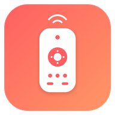

# Casto 📡

<p align="center">
  
</p>

<p align="center">
  <b>A modern, high-performance ADB Remote & Low-Latency Screen Mirroring client for Android TV & Android devices.</b><br>
  Built with <b>Kotlin</b>, <b>Jetpack Compose (Material 3)</b>, <b>scrcpy protocol</b>, and <b>dadb</b> (pure-Kotlin ADB socket engine).
</p>

<p align="center">
  
  
  
  
</p>

---

## 🌟 Overview

**Casto** turns your Android phone or tablet into an ultra-responsive, zero-latency controller and companion display for Android TV boxes, projectors, dongles, and secondary Android devices.

Unlike traditional remotes that rely on cloud servers, infrared, or proprietary TV manufacturer protocols, Casto communicates **directly over local Wi-Fi via ADB and scrcpy sockets**. No account required, no telemetry, no ads.

---

## ✨ Features

### 📺 1. Ultra-Low Latency Screen Mirroring (scrcpy Protocol)
- **Zero Native C++ Dependencies**: Pure Kotlin client interfacing directly with embedded `scrcpy-server`.
- **Hardware-Accelerated Video**: Decodes H.264 streams dynamically via Android `MediaCodec` and renders to a hardware `TextureView`.
- **Touch & Gesture Control**: Real-time pointer injection (tap, drag, swipe, pinch) mapped directly to remote display coordinates.
- **Dynamic Fullscreen Orientation**: Automatically switches phone orientation between sensor portrait and landscape to match the remote device ratio with zero wasted space.
- **Bandwidth & Quality Tuning**:
  - Presets: *4K Ultra* (16 Mbps, 60 fps), *1080p High* (8 Mbps, 60 fps), *720p Balanced* (4 Mbps, 30 fps), *Low Bandwidth* (2 Mbps, 30 fps).
  - Custom bitrate, max resolution cap, and frame rate settings.

### 🎮 2. Full TV Remote Navigation & Controls
- **Precision D-Pad**: Up, Down, Left, Right, and Center OK buttons with tactile haptic feedback.
- **Physical-Style Rockers**: Vertical capsules for **Channel (CH+/CH-)** and **Volume (VOL+/VOL-)**.
- **Task / App Switcher Button**: Dedicated Recents key (`KEYCODE_APP_SWITCH = 187`, scrcpy `Ctrl + S`) in all navigation toolbars and fullscreen mode.
- **Power Controls Menu**:
  - 🌙 Sleep / Standby (`input keyevent 26`)
  - 🔄 Restart System (`reboot`)
  - 🛠️ Restart to Recovery (`reboot recovery`)
  - ⚡ Restart to Fastboot / Bootloader (`reboot bootloader`)
  - 🛑 Power Off (`reboot -p`)
  - Built-in confirmation dialogs for safety.

### 📁 3. Remote File Manager & 1-Tap APK Sideloading
- Browse internal storage (`/sdcard`, `Download`, `Movies`, `Pictures`).
- **Push Files**: Upload local files, APKs, videos, or ROMs from phone to TV.
- **Pull Files**: Download remote files from TV to phone storage.
- **1-Tap APK Sideload**: Install `.apk` packages on TV directly via `pm install -r -d -t`.

### 📸 4. Instant Remote Screenshot Capture
- 1-tap TV screenshot capture from top bar (`screencap -p`).
- Instant full-screen image preview dialog.
- 1-tap **Save to Photos** (`MediaStore`) or **Share** to chat and cloud apps.

### 🔗 5. Intent Link & Video Stream Launcher
- Remotely open web links, YouTube videos, and media streams (`.m3u8`, `.mp4`) on TV.
- Android system share target: Share links from mobile browser or YouTube app directly to Casto to launch on TV.

### ⌨️ 6. Full Unicode & Multi-Lingual Text Input
- Types Chinese, English, emoji, and complex text without character loss by synchronizing clipboard (`cmd clipboard set text`) and triggering paste (`KEYCODE_PASTE = 279`).

### 🔍 7. LAN Auto-Discovery & Multi-Device History
- Scans local Wi-Fi subnet (`/24`) for devices with open ADB ports (`5555`).
- One-tap device switching with auto-reconnect.

---

## 🚀 Getting Started

### Prerequisites
- Target device (TV box, projector, or phone) must have **ADB Debugging / Network Debugging enabled**.
- Phone and target device must be connected to the same local network (Wi-Fi or Tailscale / VPN).

### Download
Grab the latest signed APK from the [Releases](https://github.com/mogeol/casto/releases) page.

---

## 🛠️ Building from Source

### Clone the Repository
```bash
git clone https://github.com/mogeol/casto.git
cd casto
```

### Build Debug APK
```bash
# Linux / macOS
./gradlew assembleDebug

# Windows (Command Prompt / PowerShell)
.\gradlew.bat assembleDebug
```
Output APK: `app/build/outputs/apk/debug/app-debug.apk`

### Build Signed Release APK
To sign your own release builds, copy `app/keystore.properties.example` to `app/keystore.properties` and fill in your signing key credentials:

```properties
storeFile=your-release.keystore
storePassword=your_store_password
keyAlias=your_key_alias
keyPassword=your_key_password
```

Then run:
```bash
./gradlew assembleRelease
```
*(If no `keystore.properties` file is present, Gradle automatically signs the release build with standard debug keys so external contributors can build immediately.)*

---

## ☕ Support & Donations

Casto is completely **free, open-source, and privacy-respecting** without any tracking, analytics, or advertisements.

If Casto makes managing your TV or remote devices easier and you'd like to support continued development and maintenance:

<div align="center">

### 支付宝扫一扫 (Alipay)

<a href="https://qr.alipay.com/fkx15004n444xvwknxa61c5">
  
</a>

<p>
  <i>手机可直接点击上方二维码或使用支付宝 App 扫码支持</i><br>
  <b><a href="https://qr.alipay.com/fkx15004n444xvwknxa61c5">👉 点击通过支付宝支持 (Alipay Link)</a></b>
</p>

### International Support (PayPal)
**[💳 Donate via PayPal (paypal.me/mogeol)](https://paypal.me/mogeol)**

</div>

Thank you for your support! 🙌

---

## 📜 Credits & Acknowledgments

Casto stands on the shoulders of these incredible open-source projects:

- **[scrcpy](https://github.com/Genymobile/scrcpy)** by Genymobile (Apache-2.0) - High-performance Android screen mirroring protocol and server.
- **[dadb](https://github.com/mobile-dev-inc/dadb)** by mobile.dev inc. (Apache-2.0) - Pure-Kotlin ADB implementation over sockets.
- **[Okio](https://github.com/square/okio)** by Square (Apache-2.0) - Fast I/O library for Kotlin and Java.
- **[Android Jetpack & Compose](https://developer.android.com/jetpack)** by Google (Apache-2.0).

---

## 📄 License

This project is licensed under the **Apache License, Version 2.0**. See the [LICENSE](LICENSE) and [NOTICE](NOTICE) files for full details.
